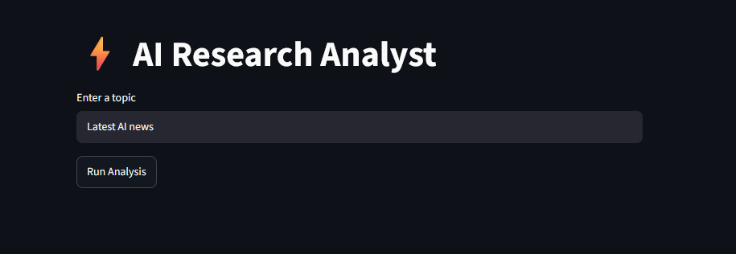
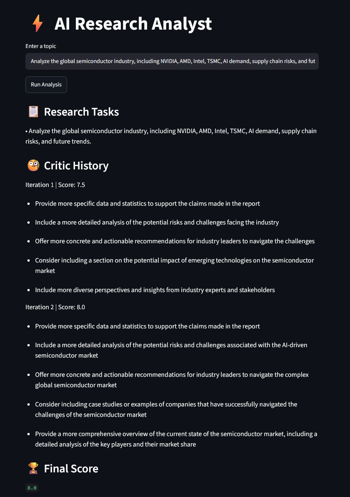
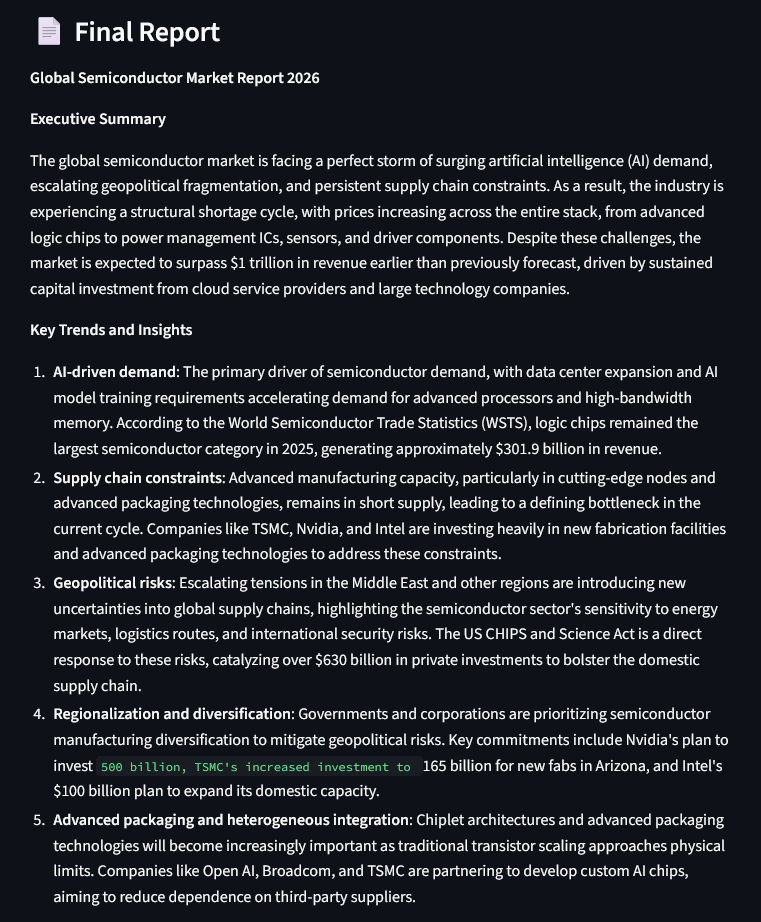
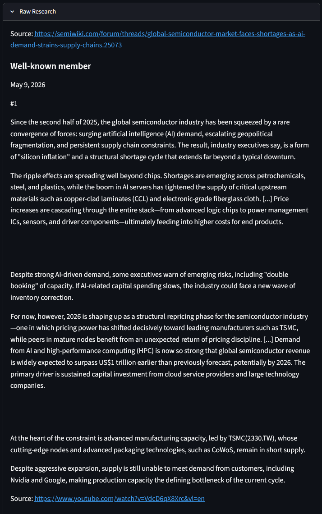

# ⚡ Multi-Agent AI Research Assistant

A multi-agent AI research system that autonomously plans research, performs real-time web search, generates structured reports, critiques its own output, and iteratively refines the report until it reaches a target quality score.

The system follows a modular agent architecture consisting of four specialized agents:

* **Planner Agent** – Breaks a research query into focused research tasks.
* **Researcher Agent** – Retrieves relevant information from the web using the Tavily Search API.
* **Editor Agent** – Produces a structured research report and revises it using critic feedback.
* **Critic Agent** – Scores the report, flags unsupported claims, and suggests improvements using structured LLM output.

## 🚀 Live Demo

**Try it here:**  
https://multi-agent-ai-research-assistant-n8g8quqzqe9pcpqejvpjen.streamlit.app/

---
## Features

* Multi-agent architecture
* Automatic task decomposition
* Real-time web research
* Structured report generation
* AI-powered report evaluation
* Hallucination check – flags claims not found in the research
* Iterative self-improvement loop
* Best-draft selection across revisions
* Streamlit web interface with live settings
* Benchmark dashboard for evaluation runs
* Downloadable Markdown reports
* Structured output using Pydantic

---

# Architecture

```text
                     User Query
                          │
                          ▼
                  Planner Agent
                          │
          Generates 3 Research Tasks
                          │
                          ▼
               Researcher Agent(s)
                          │
        Tavily Advanced Web Search
                          │
                          ▼
             Combined Research Notes
                          │
                          ▼
                   Editor Agent
                          │
              Initial Research Report
                          │
                          ▼
                   Critic Agent
                          │
     Structured Evaluation (Score, Reasoning,
     Unsupported Claims, Improvements)
                          │
               Score >= Target ?
                 ┌────────┴────────┐
                 │                 │
                Yes               No
                 │                 │
                 ▼                 ▼
       Best-Scoring Draft   Editor Revises Report
                                   │
                                   └──────────────► Critic
```

---

# Tech Stack

* Python
* Streamlit
* LangChain
* Groq API
  * Planner – GPT-OSS 20B
  * Editor – GPT-OSS 20B
  * Critic – GPT-OSS 120B
* Tavily Search API
* Pydantic
* Pandas
* Python Dotenv

---

# Project Structure

```text
multi-agent-ai-research-assistant/

│
├── agents/
│   ├── planner.py
│   ├── researcher.py
│   ├── editor.py
│   └── critic.py
│
├── evals/
│   ├── queries.txt
│   ├── run_benchmark.py
│   └── result_final.json
│
├── screenshots/
├── app.py
├── pipeline.py
├── requirements.txt
└── README.md
```

---

# How It Works

## 1. Planner Agent

The Planner Agent receives the user's query and decomposes it into **three focused research tasks**.

Example

**Input**

```
Future of Quantum Computing
```

**Output**

```
• Current state of quantum hardware

• Commercial applications

• Challenges and future outlook
```

---

## 2. Researcher Agent

Each task is independently researched using the **Tavily Search API** with advanced search enabled (top 3 results per task).

The retrieved information, along with source URLs, is combined into a single research context.

---

## 3. Editor Agent

The Editor Agent transforms the collected research into a well-structured report of up to 600 words, using only facts found in the research.

During later iterations, it also receives feedback from the Critic Agent and revises the report accordingly.

---

## 4. Critic Agent

The Critic Agent evaluates the report against the research notes using a structured Pydantic schema.

Evaluation criteria include:

* Accuracy – every claim and number must appear in the research
* Coverage – uses the most important findings
* Clarity – well organised and easy to follow
* Usefulness – gives the reader clear takeaways

It returns:

* Quality score (1–10)
* One-sentence reasoning for the score
* List of unsupported claims
* Up to 3 improvement suggestions

---

## 5. Iterative Refinement

If the report score is below the configured threshold, the report is revised.

This process repeats until:

* the target score is reached, or
* the maximum number of revisions is exceeded.

The highest-scoring draft is returned as the final report.

---

# Installation

Clone the repository

```bash
git clone https://github.com/vikas12900/multi-agent-ai-research-assistant.git

cd multi-agent-ai-research-assistant
```

Install dependencies

```bash
pip install -r requirements.txt
```

Create a `.env` file

```env
GROQ_API_KEY=your_groq_api_key
TAVILY_API_KEY=your_tavily_api_key

# Optional: seconds to wait between LLM calls (helps with rate limits)
LLM_PAUSE_SECONDS=0
```

Run the application

```bash
streamlit run app.py
```

---

# Configuration

| Setting | Default | Where |
|---|---|---|
| Target critic score | 8 | `pipeline.py` / app sidebar |
| Max revisions | 2 | `pipeline.py` / app sidebar |
| Pause between LLM calls | 0s | `LLM_PAUSE_SECONDS` in `.env` |

---

# Example Workflow

1. Enter a research topic.
2. Planner Agent generates three research tasks.
3. Researcher Agent gathers information from the web.
4. Editor Agent writes the first draft.
5. Critic Agent evaluates the report and flags unsupported claims.
6. If required, the Editor revises the report using the critic's suggestions.
7. The best report and evaluation history are displayed.

---

# Example Output

The application displays:

* Final score, first-draft score, improvement and number of critic rounds
* Final research report (downloadable as Markdown)
* Critic history with score chart, reasoning, unsupported claims and every draft
* Generated research tasks
* Source links
* Raw research collected from Tavily
* Benchmark dashboard comparing evaluation runs

---

# Benchmark

The pipeline is evaluated on 9 real-world research queries (`evals/queries.txt`).

Run a benchmark

```bash
python -m evals.run_benchmark final
```

Results are saved to `evals/result_<label>.json` and can be explored in the **Benchmarks** tab of the app.

Latest results (`result_final.json`)

| Metric | Value |
|---|---|
| Queries | 9 |
| Avg first-draft score | 8.56 |
| Avg final score | 8.78 |
| Avg critic rounds | 1.3 |
| Queries with no unsupported claims | 6 / 9 |

---
## 📸 Application Preview

### Home



---

### Critic History



---

### Final Report



### Raw Research And Sources



# Future Improvements

* Parallel execution of research tasks
* Inline citations in reports
* PDF report export
* Source credibility ranking
* Multi-model support
* Long-term memory
* Side-by-side report version comparison

---
